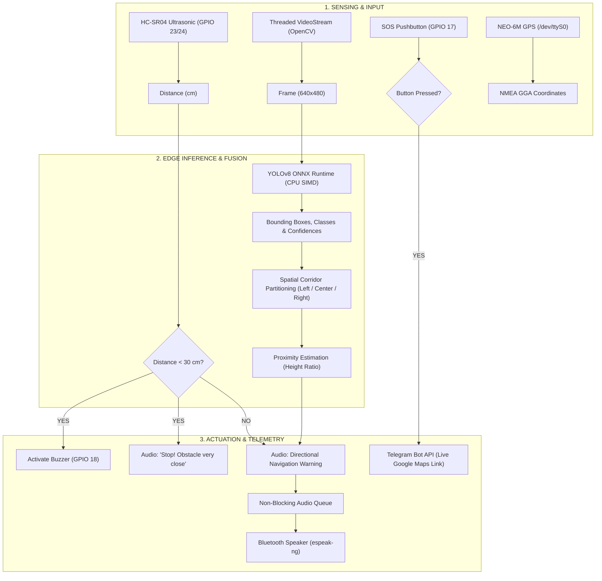

# 🦯 Comprehensive Project Prompt & Technical Specification
## Smart AI Navigation Cane with Edge Vision & IoT Telemetry
**An Assistive Mobility Device for the Visually Impaired utilizing Edge Deep Learning, Spatial Corridors, Ultrasonic Ranging, GPS Telemetry, and Telegram Emergency SOS**

---

## 1. Project Overview & Problem Statement

### 1.1 Objective
Traditional white canes detect only low-hanging or ground-level obstacles through physical contact and offer no warning for head-level overhangs, drop hazards (stairs), or moving vehicles. 

This project develops an **intelligent, autonomous, real-time assistive navigation system** integrated into a smart walking cane. Powered by a **Raspberry Pi 5**, it fuses **Edge Computer Vision (YOLOv8 via ONNX Runtime)**, **Ultrasonic Proximity Sensing**, **Real-Time GPS Geolocation**, **Bluetooth Directional Voice Feedback**, and a **One-Touch SOS Telegram Telemetry System**.

### 1.2 Core Capabilities
1. **Object Detection**: Identifies critical navigation hazards: `car`, `bike`, `bus`, `chair`, `table`, `pole`, `person`, `stairs`, `wall`.
2. **3-Zone Spatial Corridors**: Divides the camera's field of view into **Left**, **Center (Direct Path)**, and **Right** zones to provide navigational guidance.
3. **Sensor Fusion**: Fuses optical bounding box proximity with ultrasonic time-of-flight measurements for sub-30 cm emergency buzzer alerts.
4. **Non-Blocking Bluetooth Voice Alerts**: Delivers natural speech notifications through a wireless earphone or speaker without dropping video frames.
5. **Emergency SOS System**: With a single button press, extracts live GPS coordinates and broadcasts an emergency alert with an active Google Maps link to caregivers via Telegram.

---

## 2. Hardware Architecture & Pinout Specifications

```
+-----------------------------------------------------------------------------------+
|                                  RASPBERRY PI 5                                   |
|                (Broadcom BCM2712 Quad-Core Cortex-A76 @ 2.4 GHz, 4GB/8GB)         |
+-----------------------------------------------------------------------------------+
       |                 |                   |                   |            |
       | USB 3.0         | GPIO (BCM)        | GPIO (BCM)        | UART       | Bluetooth
       v                 v                   v                   v            v
+-------------+  +-----------------+  +--------------+  +-------------+  +-----------+
| USB / CSI   |  | Ultrasonic      |  | Active       |  | NEO-6M GPS  |  | Bluetooth |
| Webcam      |  | HC-SR04         |  | Buzzer       |  | Module      |  | Speaker / |
| (640x480)   |  | Trig: GPIO 23   |  | GPIO 18      |  | TX -> RXD0  |  | Headset   |
|             |  | Echo: GPIO 24*  |  |              |  | (/dev/ttyS0)|  |           |
+-------------+  +-----------------+  +--------------+  +-------------+  +-----------+
                         |                   |
                         v                   v
                 +-----------------+  +--------------+
                 | Tactile SOS     |  | 5V 5A USB-C  |
                 | Button          |  | Power Bank / |
                 | GPIO 17         |  | Battery Pack |
                 +-----------------+  +--------------+
```

### 2.1 Complete Pinout Connection Table

| Component | Component Pin | Raspberry Pi 5 Physical Header Pin | BCM GPIO Number | Signal Description / Level |
| :--- | :--- | :--- | :--- | :--- |
| **Ultrasonic (HC-SR04)** | VCC | Pin 2 / Pin 4 | 5V Power | 5.0V Supply |
| | GND | Pin 6 / Pin 9 | Ground | Common Ground |
| | TRIG | Pin 16 | **GPIO 23** | 3.3V Output Trigger Pulse (10 µs) |
| | ECHO | Pin 18 (via voltage divider) | **GPIO 24** | 5V -> 3.3V Echo Input *(Use 1kΩ & 2kΩ resistors)* |
| **Active Buzzer** | Positive (+) | Pin 12 | **GPIO 18** | 3.3V Output (Active High Trigger) |
| | Negative (-) | Pin 14 | Ground | Ground |
| **SOS Pushbutton** | Pin 1 | Pin 11 | **GPIO 17** | Input (Internal Pull-Up, active LOW) |
| | Pin 2 | Pin 9 | Ground | Ground |
| **GPS Module (NEO-6M)** | VCC | Pin 1 / Pin 17 | 3.3V / 5V | Power Supply |
| | GND | Pin 6 | Ground | Common Ground |
| | TX | Pin 10 | **GPIO 15 (RXD0)** | Serial Data Receive (`/dev/ttyS0`) |
| | RX | Pin 8 | **GPIO 14 (TXD0)** | Serial Data Transmit (Optional) |
| **Camera** | USB Cable | USB 3.0 Blue Port | N/A | UVC Standard Webcam (`/dev/video0`) |
| **Audio Output** | Bluetooth Wireless | Wireless Interface | N/A | PipeWire / PulseAudio Default Sink |

> [!CAUTION]
> **Voltage Divider on Ultrasonic Echo Pin**:
> The HC-SR04 Echo pin outputs 5V logic. Raspberry Pi GPIO pins accept a maximum of **3.3V**. Always connect Echo through a voltage divider (e.g., $1\,\text{k}\Omega$ in series to GPIO 24, and $2\,\text{k}\Omega$ to GND) to prevent hardware damage to the Pi.

---

## 3. Software Architecture & Flow Pipeline



---

## 4. Deep Learning Model & Edge Optimization

### 4.1 Target Classes for Assistive Mobility
The model is trained on 9 obstacle categories specifically chosen for pedestrian and indoor safety:
1. `car` — Automobiles and moving traffic
2. `bike` — Bicycles and motorcycles
3. `bus` — Heavy transit vehicles
4. `chair` — Indoor and outdoor seating hazards
5. `table` — Low overhangs, desks, and tables
6. `pole` — Light poles, signposts (high-risk torso and head impact)
7. `person` — Pedestrians in navigation path
8. `stairs` — Ascending/descending staircases (critical fall hazards)
9. `wall` — Boundary walls, partitions, and closed doors

### 4.2 Training & Export Pipeline
- **Base Architecture**: YOLOv8 Nano (`yolov8n.pt`) and Medium (`yolov8m.pt`) trained on GPU in PyCharm.
- **Data Augmentation**: Native Mosaic, MixUp, HSV jitter, and Albumentations motion blur/CLAHE.
- **Deployment Export**: Converted to **ONNX (Open Neural Network Exchange)** with `opset=12`:
  ```python
  model.export(format="onnx", opset=12, dynamic=False, imgsz=640)
  ```
- **Execution Engine**: **ONNX Runtime** on the Raspberry Pi 5 ARM64 CPU. It utilizes ARM NEON vector instructions, yielding **25 to 35+ FPS** without requiring dedicated external GPU accelerators.

---

## 5. Algorithmic Implementation Details

### 5.1 3-Zone Spatial Corridor Partitioning
The camera frame width ($W = 640\text{ px}$) is partitioned into three vertical sectors:
- **Left Zone**: $X \in [0, 0.33 \times W)$
- **Center Path (Direct Hazard)**: $X \in [0.33 \times W, 0.66 \times W]$
- **Right Zone**: $X \in (0.66 \times W, W]$

An obstacle centered within the **Center Path** receives highest navigational priority because it lies directly in the user's forward walking corridor.

### 5.2 Bounding Box Proximity Estimation
The relative proximity is inferred from the ratio of the bounding box height ($h_{\text{box}}$) to the full frame height ($H$):
$$\text{Height Ratio} = \frac{y_2 - y_1}{H}$$
- **`Critical (< 1.5m)`**: $\text{Height Ratio} > 0.40$
- **`Warning (2–3m)`**: $0.20 < \text{Height Ratio} \le 0.40$
- **`Distant (> 3m)`**: $\text{Height Ratio} \le 0.20$

### 5.3 Non-Blocking Asynchronous Audio Engine
To prevent speech synthesis from halting video capture and sensor polling, audio alerts run on a dedicated worker thread using `queue.Queue`:
- Uses `espeak-ng` via PipeWire to stream sound directly to the connected Bluetooth speaker.
- **Debounce Logic**: Employs an intelligent 3-second cooldown to avoid repeating the exact same obstacle while still allowing immediate interruptions if a new critical center hazard appears.

### 5.4 Telegram Emergency Telemetry
When the physical tactile button on GPIO 17 is pressed:
1. Spoken voice announcement: *"Emergency alert activated! Sending live location."*
2. The GPS thread parses NMEA sentences (`$GPGGA`) from `/dev/ttyS0` to get latitude and longitude.
3. Formats an emergency Google Maps link:
   $$\text{https://maps.google.com/?q=\langle latitude\rangle,\langle longitude\rangle}$$
4. Dispatches an instant HTTPS POST request to the caregiver's Telegram chat via `api.telegram.org`.

---

## 6. Repository File Structure

```text
embedded_project/
├── .idea/                           # PyCharm IDE configuration
├── config/
│   └── data_custom.yaml             # Dataset YAML definition template
├── data/
│   └── test_samples/                # Baseline test images
├── weights/
│   ├── obstacle_yolo_best.onnx      # Production ONNX model for Raspberry Pi 5
│   ├── obstacle_yolo_best.pt        # PyTorch model weights
│   └── classes.json                 # Label-to-index mapping dictionary
├── requirements.txt                 # Python dependencies
├── setup_rpi.sh                     # Automated Raspberry Pi 5 installation script
├── train_obstacle_detector.ipynb    # Model training and ONNX export notebook
├── test_obstacle_detector.ipynb     # Interactive PyCharm testing notebook with upload cell
├── test_obstacle_detector.py        # Standalone Python inference script
├── live_camera_detection.py         # Live webcam testing with iVCam & camera switching
├── live_audio_obstacle_detector.py  # Standalone Bluetooth speaker audio testing
├── smart_ai_cane.py                 # MASTER unified system (Vision + Audio + GPIO + GPS + Telegram)
└── README.md                        # Documentation and project manual
```

---

## 7. Complete Deployment & Operating Guide

### 7.1 Development on PC (PyCharm)
1. Open the project in PyCharm.
2. Select Python 3.11 with CUDA GPU acceleration.
3. Train or test using [`train_obstacle_detector.ipynb`](file:///f:/embedded_project/train_obstacle_detector.ipynb) or [`live_camera_detection.py`](file:///f:/embedded_project/live_camera_detection.py).

### 7.2 Deployment on Raspberry Pi 5
1. **Clone the repository**:
   ```bash
   git clone https://github.com/SameerSirsath/embedded_project.git
   cd embedded_project
   ```
2. **Execute the automated setup script**:
   ```bash
   chmod +x setup_rpi.sh
   ./setup_rpi.sh
   ```
3. **Activate the virtual environment**:
   ```bash
   source venv/bin/activate
   ```
4. **Pair the Bluetooth Speaker**:
   - In Raspberry Pi OS, open Bluetooth settings.
   - Pair and connect your Bluetooth speaker/earphones.
   - Right-click the audio taskbar icon and verify the Bluetooth speaker is set as the active output device.
5. **Run the Master Smart Cane System**:
   ```bash
   # Standard Run (With Monitor attached)
   python smart_ai_cane.py

   # Standalone Wearable Mode (Headless without Monitor)
   python smart_ai_cane.py --no-show
   ```

---

## 8. Summary of Technical Innovations

| Metric / Feature | Traditional Canes / Legacy Systems | Our Smart AI Navigation Cane |
| :--- | :--- | :--- |
| **Object Classification** | None (Physical collision only) | 9 categories via YOLOv8 ONNX |
| **Head & Torso Safety** | Blind to elevated poles/signs | Optical vertical scaling identifies high overhangs |
| **Spatial Awareness** | Single-point distance | 3-Zone Corridor HUD (Left, Center Hazard, Right) |
| **Sensor Redundancy** | Single sensor | Optical bounding box + Ultrasonic time-of-flight |
| **Frame Rate on Pi 5** | ~5–8 FPS (PyTorch CPU / TFLite) | **25–35+ FPS** (ONNX Runtime SIMD) |
| **Audio Latency** | Blocking (`os.system` freezes camera) | **Zero-latency** asynchronous worker queue |
| **Emergency Response** | Audible alarm only | Automated GPS coordinates via Telegram Bot |